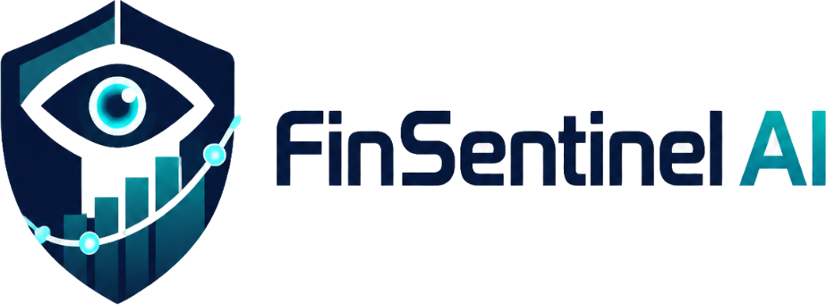

<p align="center">
  <picture>
    <source media="(prefers-color-scheme: dark)" srcset="docs/assets/logo.png">
    
  </picture>
</p>

<p align="center">
  <strong>Autonomous FinOps, Smart Procurement & AI-Audited Double-Entry Ledger Operating System</strong>
</p>

<p align="center">
  <a href="https://openjdk.org/projects/jdk/21/"></a>
  <a href="https://spring.io/projects/spring-boot"></a>
  <a href="https://spring.io/projects/spring-ai"></a>
  <a href="https://github.com/pgvector/pgvector"></a>
  <a href="https://redis.io/"></a>
  <a href="https://react.dev/"></a>
  <a href="https://tailwindcss.com/"></a>
</p>

<p align="center">
  <a href="#-executive-overview">Executive Overview</a> •
  <a href="#-key-capabilities">Key Capabilities</a> •
  <a href="#-system-architecture">System Architecture</a> •
  <a href="#-security--distributed-invariants">Distributed Invariants</a> •
  <a href="#-high-density-linear-ui">Linear UI/UX</a> •
  <a href="#-quick-start">Quick Start</a> •
  <a href="#-api--telemetry-spec">API & Telemetry</a>
</p>

---

## 🌟 Executive Overview

**FinSentinel AI** is an enterprise-grade autonomous financial operating system built to reconcile corporate treasury, intercept procurement fraud in real time, and audit general ledger double-entry invariants with zero human latency. 

Inspired by the design philosophies of **Linear**, **Stripe Dashboard**, and **Apple macOS Sequoia**, FinSentinel AI pairs microsecond distributed execution with a bespoke, surgical, high-density telemetry interface.

```
+---------------------------------------------------------------------------------------------------------+
|                                    FinSentinel AI Platform Topology                                     |
+---------------------------------------------------------------------------------------------------------+
|                                                                                                         |
|   [ Ingestion & PDF Parser ] ----> [ Forensic Anomaly Engine ] ----> [ Distributed Ledger Engine ]      |
|     • Apache PDFBox 3.x              • 90-Day Variance Benchmarks      • ACID Isolation.SERIALIZABLE    |
|     • GSTIN & Regex Synthesizer      • Duplicate Invoicing Traps       • Invariant: Σ(Debit) == Σ(Credit)|
|     • Flyway Migration Versioning    • STOMP Anomaly Broadcast         • Redisson Distributed Locks     |
|                                                                                                         |
|   [ Spring AI Copilot Layer ] <---> [ pgvector Knowledge Store ] <---> [ Real-Time Telemetry Client ]    |
|     • Safe Tool Calling (MCP)        • HNSW Index Cosine Distance      • STOMP over SockJS / WebSocket  |
|     • Corporate Governance RAG       • Policy Invariance Matcher       • Linear High-Density UI/UX      |
|                                                                                                         |
+---------------------------------------------------------------------------------------------------------+
```

---

## ⚡ Key Capabilities

### 1. High-Concurrency Double-Entry General Ledger
* **ACID Isolation.SERIALIZABLE**: Guaranteed balance sheet integrity eliminating write skew and phantom reads.
* **Strict Mathematical Precision**: Standardized on `java.math.BigDecimal` with `RoundingMode.HALF_UP` (Scale 4 internal calculations, Scale 2 financial display).
* **Zero-Balance Invariance**: Mathematically enforces $\sum \text{Debit} \equiv \sum \text{Credit}$ on every atomic journal entry. Unbalanced postings trigger an RFC 7807 `UnbalancedLedgerException` with an HTTP 422 payload.
* **Redisson Distributed Idempotency**: Prevents multi-payout duplicate disbursements across distributed nodes using cluster-wide Redis locking.

### 2. Autonomous Smart Procurement & Fraud Triage
* **Apache PDFBox 3.x Streaming**: Headless ingestion and regex synthesis of multi-page enterprise invoices.
* **Deterministic Policy Gates**:
  * **Price Surge Interceptor (`POL-001`)**: Intercepts line-item unit pricing deviating $>15\%$ against trailing 90-day vendor contract averages.
  * **Duplicate Invoice Trapping (`POL-003`)**: Real-time cross-vendor invoice fingerprint deduplication.
  * **GST Compliance Engine**: Invariant verification for Indian GST structures (CGST 9% + SGST 9% or IGST 18%).
* **Autonomous Auto-Disbursement**: Clean invoices within pre-authorized budget limits are immediately booked into the ledger without human intervention.

### 3. "Ask FinSentinel" Agentic Copilot & MCP Tools
* **pgvector Hybrid RAG**: Vector embeddings over corporate financial policies stored in PostgreSQL with HNSW indexing (`COSINE_DISTANCE`).
* **Surgical Model Context Protocol (MCP)**: Sandbox execution of role-gated Java tool functions:
  * `getLedgerBalanceSummary(accountType, dateRange)`
  * `getTopVendorsBySpend(limit)`
  * `getFlaggedAnomalies(minRiskScore)`
  * `verifyGstCompliance(vendorGstin)`
* **Dynamic Visualization Synthesis**: Returns structured JSON payloads rendered dynamically as high-density Recharts components in the chat stream.

### 4. Live Telemetry & STOMP WebSocket Fabric
* **Sub-2ms Broadcasts**: CFO metrics, liquidity runways, burn rates, and anomaly events streamed directly via `/topic/telemetry` and `/topic/anomaly-alerts`.
* **State Machine Resiliency**: Instant reconnect fallback, optimistic UI state updates, and client-side heartbeat validation.

---

## 🎨 Linear & Apple-Grade UI Design System

The frontend is an uncompromising visual overhaul engineered according to strict Apple macOS Sequoia and Linear Dark Mode guidelines:

* **True Obsidian Canvas**: `#09090B` (`bg-zinc-950`) canvas foundation with elevated `#0F0F12` glassmorphic cards.
* **Hairline Specular Highlights**: Micro-subtle `border-white/[0.06]` paired with top-edge specular illumination `shadow-[inset_0_1px_0_0_rgba(255,255,255,0.05)]`.
* **Surgical Tabular Numerals**: Enforces `tabular-nums` on every financial balance, percentage, invoice identifier, and timestamp for decimal alignment.
* **24px Linear Bottom Status Bar**: Real-time telemetry footer displaying Java 21 Virtual Thread pool health, Redisson distributed lock status, pgvector index health, and end-to-end API latency.
* **Linear Segmented Allocation Visualizer**: Replaced outdated donut charts with horizontal segmented allocation bars and high-density financial variance tables.

---

## 📁 Repository Structure

```
FinSentinel-AI/
├── docs/
│   └── assets/                     # Clean vector & raster logo assets
├── nginx/
│   └── nginx.conf                  # HTTP/2 reverse proxy, Gzip & STOMP WebSocket upgrade
├── backend/
│   ├── Dockerfile                  # Multi-stage Eclipse Temurin 21 JRE with ZGC & Virtual Threads
│   ├── pom.xml                     # Spring Boot 3.3.5, Spring AI, Redisson, Flyway, PDFBox
│   └── src/main/
│       ├── java/com/finsentinel/
│       │   ├── common/             # RFC 7807 ProblemDetail, @AuditedAction AOP, @Idempotent AOP
│       │   ├── config/             # Security, Redis, WebSocket, Virtual Threads, OpenAPI, Spring AI
│       │   ├── auth/               # Stateless JWT, Refresh Token Rotation & Blacklisting in Redis
│       │   ├── ledger/             # BigDecimal arithmetic, Isolation.SERIALIZABLE, DoubleEntryEngine
│       │   ├── procurement/        # PDFBox Parser, AnomalyTriageService, Vendor directory
│       │   ├── ai/                 # pgvector RAG, Model Context Protocol (MCP) Tool Beans, Copilot
│       │   └── telemetry/          # STOMP Telemetry Broadcaster, CFO Dashboard Service
│       └── resources/
│           ├── application.yml     # Production Virtual Thread & HikariCP pool configuration
│           └── db/migration/
│               └── V1__init_schema_and_pgvector.sql # Flyway migration & pgvector schema
└── frontend/
    ├── Dockerfile                  # Multi-stage Node 22 build -> Nginx Alpine runner
    ├── package.json                # React 19, TanStack Query v5, Zustand, Recharts, Lucide
    ├── tsconfig.json               # Strict TypeScript (0 any types allowed)
    ├── tailwind.config.js          # Linear / Apple Sequoia True Obsidian color palette
    └── src/
        ├── api/                    # Axios client with JWT refresh queue & Idempotency-Key injection
        ├── store/                  # Zustand authStore & telemetryStore (STOMP client)
        ├── components/
        │   ├── Header.tsx          # Linear breadcrumb navigation with official brand shield
        │   ├── Sidebar.tsx         # Single-line 32px nav items with 6px status indicators
        │   ├── StatusBar.tsx       # 24px VS Code / Linear bottom telemetry bar
        │   └── LiveAnomalyTicker.tsx # Desaturated Raycast floating alert feed
        └── pages/
            ├── CfoDashboard.tsx    # High-density KPIs, 1.5px gradient AreaChart, Fraud queue table
            ├── LedgerExplorer.tsx  # Double-entry ledger, Trial Balance, Invariant modal
            ├── SmartProcurement.tsx# PDFBox drag-and-drop parser, AI triage queue, Vendor matrix
            └── FinSentinelCopilot.tsx # Raycast copilot prompt, MCP execution badges, dynamic charts
```

---

## 🔒 Security & Distributed Invariants

| Invariant / Mechanism | Implementation Specification | Guarantee |
| :--- | :--- | :--- |
| **Ledger Invariant** | `@Transactional(isolation = Isolation.SERIALIZABLE)` | $\sum \text{Debit} \equiv \sum \text{Credit}$ per Journal Entry |
| **Double-Payout Guard** | Redisson distributed lock + Redis idempotency key | Zero duplicate disbursements on network retry |
| **Audit Log Immutability** | `@AuditedAction` Spring AOP Aspect | Cryptographic-ready historical event trail |
| **Stateless Auth** | Short-lived JWT (15m) + Redis Refresh Rotation | Immediate revocation and blacklisting |
| **Role-Based Access (RBAC)**| Spring Security Method Security (`@PreAuthorize`) | Explicit least-privilege role boundaries |

---

## 🚀 Quick Start

### Prerequisites
- [Docker](https://docs.docker.com/engine/install/) & [Docker Compose](https://docs.docker.com/compose/)
- Java 21 JDK (optional, for local non-container development)
- Node.js 20+ & npm (optional, for local frontend iteration)

### 1. Launch with Docker Compose
Clone the repository and boot the unified production stack:

```bash
git clone https://github.com/KGobikrishnan/FinSentinel-AI.git
cd FinSentinel-AI
docker compose up --build -d
```

### 2. Verify Services
The reverse proxy orchestrates all traffic over port `80`:

* **Web Application**: [http://localhost](http://localhost)
* **OpenAPI 3.0 / Swagger UI**: [http://localhost/swagger-ui.html](http://localhost/swagger-ui.html)
* **Spring Boot Actuator Health**: [http://localhost/actuator/health](http://localhost/actuator/health)
* **STOMP WebSocket Broker**: `ws://localhost/ws-raw` or SockJS `http://localhost/ws`

---

## 🔑 Enterprise Seed Credentials

The database automatically initializes with sample accounts, vendor contracts, corporate policies, and test personas:

| Role | Username | Password | Email | Permissions |
| :--- | :--- | :--- | :--- | :--- |
| **CFO Admin** | `cfo_admin` | `Admin@123` | `cfo@finsentinel.ai` | Unrestricted Treasury & Policy Override |
| **Lead Auditor** | `finance_auditor` | `Admin@123` | `auditor@finsentinel.ai` | Trial Balance & Forensic Review |
| **Procurement Head** | `procurement_mgr` | `Admin@123` | `procurement@finsentinel.ai` | Invoice Triage & Vendor Benchmarking |
| **Vendor Rep** | `vendor_cloudcorp` | `Admin@123` | `vendor@cloudscale.io` | Self-Service Invoicing & Status Tracking |

---

## 📊 API & Telemetry Endpoints

### Authentication & Sessions
* `POST /api/v1/auth/login` — Returns JWT Access Token + Redis Refresh UUID.
* `POST /api/v1/auth/refresh` — Rotates refresh token and issues fresh access token.
* `POST /api/v1/auth/logout` — Blacklists refresh token in Redis.

### Core Ledger Engine
* `GET /api/v1/ledger/accounts` — Returns chart of accounts with real-time balance calculations.
* `GET /api/v1/ledger/entries` — Lists all audited journal entries and lines.
* `POST /api/v1/ledger/entries` — Posts atomic journal entry (requires `Idempotency-Key` header).
* `GET /api/v1/ledger/trial-balance` — Generates real-time balanced trial balance sheet.

### Procurement & Fraud Forensics
* `POST /api/v1/procurement/invoices/upload` — Ingests multi-part PDF via Apache PDFBox 3.x.
* `GET /api/v1/procurement/invoices` — Returns triaged invoice stream filtered by risk tier.
* `POST /api/v1/procurement/invoices/{id}/review` — Dual-authorization approval or rejection.

### Agentic Copilot (MCP & RAG)
* `POST /api/v1/ai/copilot/chat` — Contextual policy RAG with dynamic chart synthesis.

---

## 📄 License & Attribution

Distributed under the Apache 2.0 License. Built with precision for enterprise treasury, autonomous procurement, and high-assurance financial systems.
